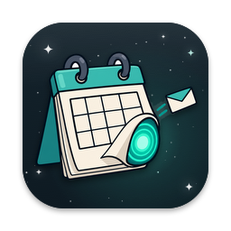
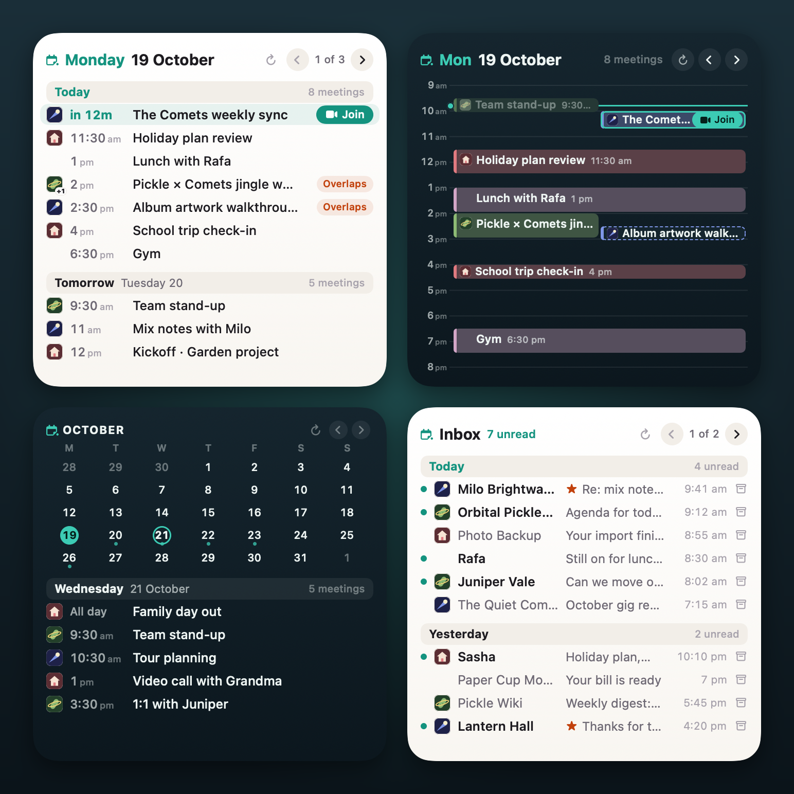
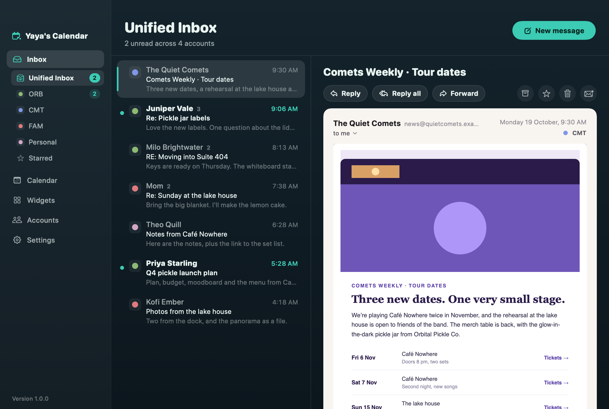
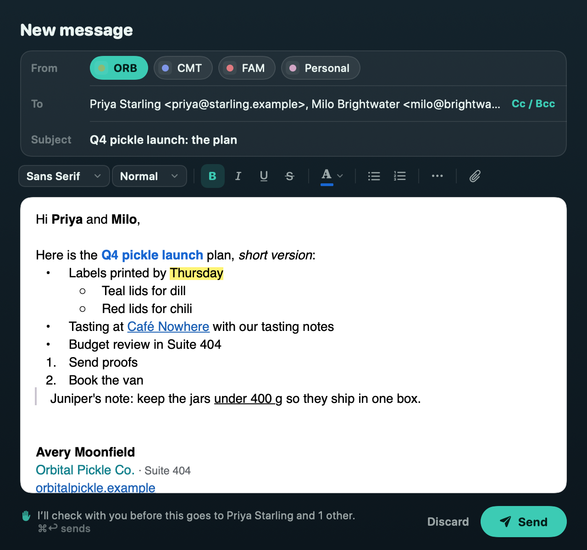
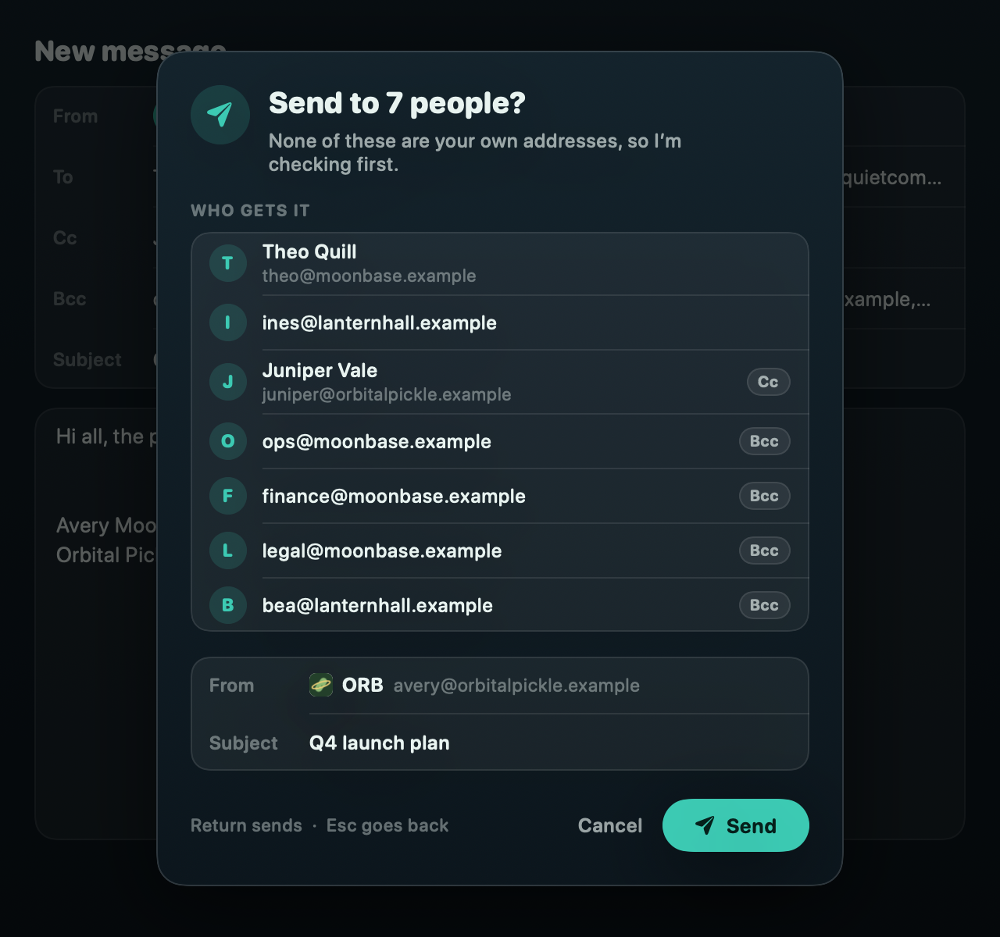

<p align="center">
  
</p>

<h1 align="center">Yaya’s Calendar</h1>

<p align="center">
  All your Google calendars and inboxes. One desk.<br>
  Desktop widgets that show your whole day, not three meetings and a “+5 more” you can’t tap.
</p>

<p align="center">
  
  
  
  
</p>

<p align="center">
  <a href="https://github.com/YahyaElghobashy/yayas-calendar-mac/releases/latest/download/Yayas-Calendar-macOS-arm64.zip">
    
  </a>
</p>

<p align="center">
  
</p>

## Why this thing exists

Every calendar widget I tried on the Mac did the same thing: three events, then a “+5 more” that goes
nowhere when you tap it. None of them told me two meetings at 2 pm were about to fight each other, and
my inbox wasn’t on the desktop at all.

So this one shows the whole day. The Day widget lays overlapping meetings side by side, the Agenda pages
through the week, Up Next counts down to your next call and hands you a Join button, and the Inbox lets
you mark read and archive mail without opening anything.

If you have a work Google account, a personal one and a third one you only remember during password
resets, they all land on the same desk here. Your Mac talks to Google directly. There is no Yaya’s
Calendar server in the middle, because there is no Yaya’s Calendar server.

## What it does

- **Twelve widgets, up to five sizes.** Agenda, Day, Up Next, Month, Inbox, Agenda & Inbox and six
  Custom slots, from Small to Extra Large, plus Extra Large Portrait on macOS 27. Each one picks Light
  or Dark, its font, its text size and which calendars it shows (the Widgets page in the app).
- **A Day view that admits to double-booking.** Overlapping meetings sit side by side, each with its
  account’s logo, and a teal line marks now. Arrows flip to the next day.
- **A Month you can tap.** Tap a day and its meetings appear beside or under the grid (on Small, in a
  peek).
- **Up Next and Join.** A countdown to your next meeting and one big Join button. **⌃⌥J** joins it from
  anywhere, the menu bar counts down to it, and a heads-up arrives a minute before, with Join on it.
- **Join with Fathom.** Got Fathom’s Mac app and more than one Fathom account? Each account in the app
  links to its own Fathom account, and Join with Fathom (popover, Event Peek, Up Next, the heads-up, and ⌃⌥J if
  you like) records the meeting there. If Fathom is signed into a different account, it waits for you to switch
  instead of recording in the wrong place.
- **Join with Yaya’s Murmur.** With Yaya’s Murmur, the bot-free notetaker by the same author, each account picks its
  recorder (Fathom, Yaya’s Murmur, Ask each time or Off), Join gets a ▾ with every way in, the Event Peek gets a Live
  Helper switch, and meetings show Yaya’s Murmur’s badges. Without it, nothing changes.
- **↻ on every widget.** A meeting got cancelled? Tap ↻ and that widget re-reads its calendars now
  instead of at the next 15-minute sync. It shows ✓ when it’s done.
- **One inbox for every account.** A unified inbox in the app and on the desktop. Mark read or
  archive straight from the widget, with Undo for 30 seconds.
- **Emails that look like emails.** HTML mail draws on a white sheet the way its sender designed it,
  with JavaScript off and remote images blocked until you say so. Long quoted history folds behind a
  “•••”. Hover a link and you see where it really goes.
- **A composer with a formatting bar.** Fonts, sizes, bold, italic, underline, strikethrough, colour,
  lists, indents, quotes and links, a rich signature per account, and **Make Plain Text** for the
  purists. Undo send gives you 5 seconds of regret.
- **Attachments.** Add files up to Gmail’s 25 MB per message, preview what arrives with Quick Look, open,
  save one or all, or drag them to Finder. Apps, installers, scripts and disk images ask before they
  open, every time.
- **Forward**, with the original’s files attached again.
- **Ask before sending to other people.** When a message is going to anyone outside your own accounts,
  a card lists every one of them (Cc and Bcc marked) and waits for you. It’s on unless you switch it off
  in Settings → Mail.
- **The menu bar.** A countdown title (“Standup · 7m”) and a popover with today’s agenda and your inbox.
  Unlike widgets, the popover scrolls.

<p align="center">
  
</p>

<p align="center">
  
  
</p>

## The widgets

Right-click the desktop → **Edit Widgets** → search **Yaya**.

| Widget | What it shows | S | M | L | XL | XL Portrait |
|---|---|:-:|:-:|:-:|:-:|:-:|
| **Agenda** | Your meetings from every calendar, day by day. Flip pages with the arrows. | ✓ | ✓ | ✓ | ✓ | ✓ |
| **Day** | One day hour by hour, with overlapping meetings side by side. Flip days with the arrows. | ✓ | ✓ | ✓ | ✓ | ✓ |
| **Up Next** | Your next meeting, a countdown and a Join button. | ✓ | ✓ | | | |
| **Month** | Tap a day on the calendar to see its meetings. | ✓ | ✓ | ✓ | ✓ | ✓ |
| **Inbox** | Newest mail from all your inboxes. Tap to read, mark read or archive. | | ✓ | ✓ | ✓ | ✓ |
| **Agenda & Inbox** | Meetings on one side, mail on the other. | | | ✓ | ✓ | ✓ |
| **Custom A to F** | Pick what it shows, its calendars and its look in Yaya’s Calendar → Widgets. | ✓ | ✓ | ✓ | ✓ | ✓ |

Extra Large Portrait needs macOS 27. Every widget, in every size, has the ↻ button.

## Install it (the honest version)

1. **[Download the zip](https://github.com/YahyaElghobashy/yayas-calendar-mac/releases/latest/download/Yayas-Calendar-macOS-arm64.zip)**,
   unzip it and drag **Yaya’s Calendar** into **Applications** *before* you open it. Opened straight
   from Downloads, macOS runs it from a temporary copy, and the widgets and the login item get confused.
2. Open it. macOS says it *“could not verify Yaya’s Calendar is free of malware”*. It is. It’s signed with
   its own certificate rather than one from Apple’s $99-a-year program, so macOS asks once. Go to
   **System Settings → Privacy & Security**, scroll down, click **Open Anyway**, then **Open**.
3. The welcome guide opens. First stop: **Set up Google sign-in** (next section). About five minutes,
   once.
4. **Connect your accounts.** Google says *“Google hasn’t verified this app”*. That’s the app you just
   made: click **Advanced → Go to Yaya’s Calendar (unsafe)** and tick every box.
5. **Put a widget on the desktop:** right-click the desktop → **Edit Widgets** → search **Yaya**.
6. Allow notifications if you want the heads-up a minute before each meeting, and let it start at login
   so your widgets always have someone to talk to.

Each newly downloaded version needs **Open Anyway** once. Updates keep your sign-ins: every release is
signed with the same identity, so the Keychain recognises it.

### Check the download

The release page has a `SHA256SUMS` file next to the zip. With both in the same folder:

```sh
shasum -a 256 -c SHA256SUMS                     # → Yayas-Calendar-macOS-arm64.zip: OK
codesign --verify --deep --strict "/Applications/Yaya's Calendar.app" && echo "signature intact"
codesign -d -r- "/Applications/Yaya's Calendar.app" 2>&1 | sed -n 's/^designated => //p'
```

The last line must match [`docs/DR.txt`](docs/DR.txt) at the release’s tag, word for word. That is the
designated requirement every release is signed to, and the one your Keychain items trust.
[SECURITY.md](SECURITY.md) explains what it means and what a mismatch tells you.

## Set up Google sign-in

Yaya’s Calendar has no server and no shared Google app, so you make your own private one in Google
Cloud. It’s free, only you use it, and the app walks you through it in six steps: **Accounts → Sign-in
setup** (the guide opens on its own the first time).

1. **Create a Google Cloud project.** No billing account needed.
2. **Turn on the Gmail API and the Google Calendar API.**
3. **Name your app** in Google Auth Platform: “Yaya’s Calendar”, your own email for support and contact.
4. **Audience:** choose **External**, then **Publish app** so it says *In production*. Left in *Testing*,
   Google signs you out every 7 days.
5. **Make a Desktop client:** **Create client → Desktop app → Create**, then **Download JSON** in the
   dialog that appears. Google shows the secret only once, in that dialog.
6. **Drop the file** on the guide. It goes straight into your Keychain, and the app offers to move the
   download to the Trash.

Once an account is connected, **Check my setup** tests both APIs with it. The full guide, with every
link and the fixes for the errors a fresh project produces, is [docs/GOOGLE-SETUP.md](docs/GOOGLE-SETUP.md).

Work account blocked? Your Workspace admin can trust your client: the account card shows the steps and
a **Copy client ID** button. Revoke access any time at https://myaccount.google.com/permissions, or
remove the account in the app.

## Keys

| Keys | What happens |
|---|---|
| **⌃⌥J** | Join your next meeting, from anywhere (Settings → Menu bar can switch it off; Settings → Fathom, or Settings → Yaya’s Murmur when it’s installed, can make it record too) |
| **⌘N** | New message |
| **J / K** or **↓ / ↑** | Next / previous conversation in the inbox |
| **Return** | Open it |
| **E** · **U** · **S** · **#** | Archive · mark read or unread · star · move to Trash |
| **R** · **F** | Reply · Forward |
| **⌘↵** | Send |
| **⇧⌘A** | Attach files |
| **⌘B** · **⌘I** · **⌘U** · **⇧⌘X** | Bold · italic · underline · strikethrough |
| **⇧⌘8** · **⇧⌘7** · **⇧⌘9** | Bulleted list · numbered list · quote |
| **⌘K** | Add a link |
| **⇧⌘T** | Make plain text |
| **⌥⇧⌘V** | Paste and match style |
| **Esc** | Back out of the “Send to …?” card, with everything you wrote intact |

## Privacy, precisely

- **No server, no account, no analytics.** No crash reporter and no update check either, and nothing
  ever goes to the developer.
- **Your own Google client.** Its ID and secret go into your Keychain and are only ever sent to Google.
- **Sign-ins in the Keychain.** Google refresh tokens, your client and the key that signs widget links
  live in your login Keychain, readable without a prompt only by an app with this app’s signature.
  Access tokens stay in memory.
- **Everything else in one folder:** `~/Library/Application Support/YayasCalendar/` (folders 0700, files
  0600): the mail and calendar cache, widget snapshots, attachments you opened (past 300 MB the least
  recently opened go first) and logs that record counts and error codes, never titles, addresses or
  links. The sandboxed widget reads only its own `widget/` folder.
- **A locked mail reader.** JavaScript off, a web view that keeps nothing, remote images blocked. Load
  them for one message, allow a sender, or (off by default) allow everyone you’ve written to. Images then load
  from wherever the sender keeps them, so the sender may learn you opened the message.
- **Links open in your browser:** join links, links in mail, Google’s consent and console pages.

The app talks to these hosts and no others. The list is
[`HTTP.allowedHosts`](Sources/Net/HTTP.swift), and the network layer refuses anything off it before a
connection exists:

| Host | What for |
|---|---|
| `accounts.google.com` | Google’s sign-in and consent page (it opens in your browser) |
| `oauth2.googleapis.com` | Turning a sign-in into tokens, refreshing them, revoking them when you remove an account |
| `gmail.googleapis.com` | The Gmail API: list, read, label, archive and send (big messages go through Google’s upload path on the same host) |
| `www.googleapis.com` | The Google Calendar API: your calendars, events and RSVPs |
| `openidconnect.googleapis.com` | Google’s identity service. It’s on the list, but 1.0 never calls it: your address comes with the sign-in |

**The one exception: account logos.** When you add an account on its own domain (never gmail.com), the
app asks that domain’s website for its icon over HTTPS (`/apple-touch-icon.png`, the home page’s icon
link, or `/favicon.ico`; 512 KB at most), and tells you which domain it asked. That server usually sees
one ordinary request from your Mac, seven at most. Settings → What leaves this Mac → **Fetch company
logos** turns off the automatic fetch; **Fetch logo from website** in an account’s menu still asks when
you choose it.

[`Tools/check-sealed.sh`](Tools/check-sealed.sh) fails the build when network code shows up anywhere but
the network layer, the logo fetcher, the sign-in listener (loopback only) and a network-change monitor
(no traffic), or when the host list changes. Google API data is handled under the Google API Services User Data Policy,
including its Limited Use requirements. The long version: [PRIVACY.md](PRIVACY.md).

## Build it yourself

You need an Apple silicon Mac on macOS 26 or later and the Command Line Tools with the **macOS 27 SDK**
(Swift 6.4): `xcode-select --install`. No Xcode. The macOS 26 SDK can’t build the widget extension
(it has no Extra Large Portrait), so `xcrun --show-sdk-version` should say 27 or later.

```sh
git clone https://github.com/YahyaElghobashy/yayas-calendar-mac.git
cd yayas-calendar-mac
./build.sh --dev            # a separate "Yaya's Calendar Dev" app, ad-hoc signed; needs no setup
Tools/setup-signing.sh      # once: this Mac's own signing identity, so your sign-ins survive rebuilds
./build.sh --install        # signed with it, installed to /Applications and relaunched
./build.sh --dev --test     # the tests
```

Plain `swiftc` from the Command Line Tools: no Xcode project, no package manager. The dev build has its
own bundle ids, URL scheme, data folder and Keychain names, so it never touches the real app.
`INSTALL_DIR=~/Applications ./build.sh --install` puts it somewhere else. Before a pull request, also run
`Tools/check-sealed.sh`, `Tools/check-secrets.sh` and `Tools/check-public.sh --tree .`
([CONTRIBUTING.md](CONTRIBUTING.md)).

## Known truths

- **Google only in 1.0.** No Outlook, iCloud or Exchange accounts.
- **English only.**
- **Apple silicon only, macOS 26 or later, tested on macOS 27.**
- **Self-signed, not notarized.** Gatekeeper asks once per downloaded version (Open Anyway).
- **You bring your own Google sign-in.** Google calls it unverified, which only means Google hasn’t
  reviewed it: it’s yours, and only you use it. An unverified app can be used by at most 100 Google
  accounts in its lifetime, plenty for one person.
- **Widgets are links, not App Intents.** App Intents need an Apple Team ID, so a tap opens a
  `yayacal://` link that the app handles and then steps out of the way. A widget can’t be configured in
  the gallery either, which is why there are six Custom slots you set up in the app.
- **Widgets don’t scroll.** That’s WidgetKit. They page instead, and the menu-bar popover scrolls.
- **HTML mail keeps its own colours in dark mode**, on a white sheet. Recolouring other people’s
  designs breaks too many of them.
- **Attachments over 50 MB** open in Gmail on the web.
- **Workspace admins can block apps they haven’t trusted.** The app shows what to send them.
- **No update check.** Watch the repository’s Releases.

## Under the hood, for the curious

| Piece | Where |
|---|---|
| Menu-bar agent, link routes, the status item and popover | `Sources/App` |
| Windows: inbox, calendar, widgets, accounts, settings, the composer | `Sources/UI` |
| Accounts, the Google setup guide, logos | `Sources/Accounts` |
| Sign-in (loopback + PKCE), tokens, the Keychain | `Sources/Auth` |
| Everything that touches the network: the Google API session, the logo fetcher, the sign-in listener on 127.0.0.1 | `Sources/Net`, `Sources/Accounts/LogoFetcher.swift`, `Sources/Auth/LoopbackServer.swift` |
| Gmail and Google Calendar clients, sync, the local SQLite store | `Sources/Providers`, `Sources/Sync`, `Sources/Store` |
| MIME, the HTML sanitizer, the mail writer | `Sources/Mail` |
| Widget snapshots and reloads | `Sources/Publish` |
| The widget extension and every layout | `Sources/Widget`, `Sources/Shared` |
| Notifications and the Deck export | `Sources/Notify` |

The app writes one small JSON snapshot per widget kind, and the widget only ever reads those; every tap
is a signed `yayacal://` link. [docs/CONTRACTS.md](docs/CONTRACTS.md) has the formats, the routes and the
Keychain layout, [docs/DESIGN-WIDGETS.md](docs/DESIGN-WIDGETS.md) the widget design, and
[docs/DECISIONS.md](docs/DECISIONS.md) every decision with its reason. One favourite: switching days on
the Month widget used to cost 2.8 to 5.4 seconds of widget work, and now costs 0.12 to 0.20 (D-019).

## Works with Deck

[Deck](https://github.com/YahyaElghobashy/deck-mac), a meeting recorder by the same author, can name each
recording after the meeting it belongs to. When Deck itself is installed (recognised by its bundle
identifier, checked by digest), Yaya’s Calendar keeps your next 48 hours of meetings in one local file for
it and taps it on the shoulder when they change; otherwise the export stays off. The file never leaves
your Mac. Settings → **Share upcoming meetings with Deck**, under “Stays on this Mac”, is the switch;
turning it off deletes the file. The format is in [docs/CONTRACTS.md](docs/CONTRACTS.md#deck-export). Yaya’s Murmur
reads the same file; while it’s installed the switch says so and starts on.

## For installers

Installers and scripts can drive the app with launch flags: `--permissions-json` (notifications and the
login item as one JSON line, then exit), `--login-item on|off`, `--onboarding` (the welcome guide; **Let’s
go** leaves a handoff marker file an installer can wait for), `--uninstall`, `--purge` and
`--purge --dry-run`. The details are in [docs/CONTRACTS.md](docs/CONTRACTS.md#installer-flags).

## More Mac apps by the same author

- [Yaya’s Space](https://github.com/YahyaElghobashy/yayas-space-mac)
- [YayaShot](https://github.com/YahyaElghobashy/yayashot)
- [Dailies](https://github.com/YahyaElghobashy/dailies-mac)
- [Deck](https://github.com/YahyaElghobashy/deck-mac)
- [Vibing with Yaya](https://github.com/YahyaElghobashy/vibing-with-yaya)

## Credits

Keychain access without prompts and the app’s window activation are adapted from
[Codenotch](https://github.com/vinzdg/codenotch) by Vinz (MIT); the details are in
[THIRD_PARTY_NOTICES.md](THIRD_PARTY_NOTICES.md). The icon and the mark are described in
[brand/BRAND.md](brand/BRAND.md). Everything else by [the author](https://github.com/YahyaElghobashy),
without Xcode.

Help: [SUPPORT.md](SUPPORT.md) · [Troubleshooting](docs/TROUBLESHOOTING.md) · [Security](SECURITY.md) ·
[Changelog](CHANGELOG.md).

Not affiliated with Google or Fathom. Gmail and Google Calendar are trademarks of Google LLC; Fathom is a
trademark of its owner. The Yaya’s Calendar
name and icon are reserved ([TRADEMARKS.md](TRADEMARKS.md)); the code is yours to use.

MIT licensed. Take it, break it, make it yours.
