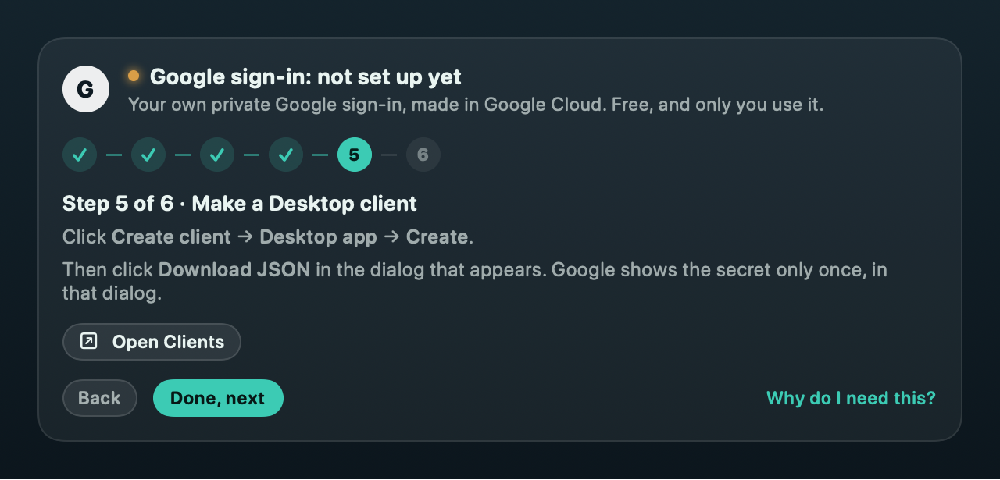

# Set up Google sign-in

Yaya’s Calendar has no server, so there is no shared Google app for it to use. You make your own private
one in Google Cloud. It’s free, only you use it, and it takes about five minutes, once.

The app walks you through the same six steps: **Accounts → Sign-in setup** (it opens on its own the first
time). Each step there has a button that opens the right Google page in your browser. This page is the
same guide in text, for reading ahead or for when something goes wrong.

  

<!-- Screenshots: each step gets one, taken in a throwaway Google Cloud project created for the purpose
     (named like "my-calendar-desk") and deleted afterwards, cropped so no account picture, email address,
     project id or project number shows, re-encoded with Tools/make-icons.sh --strip and checked with
     Tools/check-public.sh --images. Until then the text stands on its own. -->

**Why do I need this?**

- There is no Yaya’s Calendar server, so there is no shared Google app to sign in through.
- You make your own private one in Google Cloud. It’s free and only you use it.
- When Google calls it unverified, it means that app of yours, not someone else’s.

## 1. Create a Google Cloud project

Open https://console.cloud.google.com/projectcreate, sign in with any Google account and create a
project. Call it something like “Yaya’s Calendar (mine)”. No billing account is needed.

<!-- Screenshot: the New Project form with the name filled in. -->

## 2. Turn on the Gmail and Calendar APIs

Open each link, check that the project at the top of the page is yours, and click **Enable**:

- Gmail API: https://console.cloud.google.com/apis/enableflow;apiid=gmail.googleapis.com
- Google Calendar API: https://console.cloud.google.com/flows/enableapi?apiid=calendar-json.googleapis.com

<!-- Screenshot: the Gmail API page with its Enable button. -->

## 3. Name your app

Open Google Auth Platform (https://console.developers.google.com/auth/overview) and click **Get started**.

- App name: **Yaya’s Calendar**.
- Support email and contact email: your own address.

Google shows this name on its sign-in page, so pick one you’ll recognise. You can change it later under
**Branding** (https://console.developers.google.com/auth/branding).

<!-- Screenshot: the App Information step with the name filled in. -->

## 4. Choose External, then publish

Open **Audience** (https://console.developers.google.com/auth/audience). Choose **External**, then click
**Publish app** so the status says *In production*.

- Left in *Testing*, Google signs you out of every account 7 days after you approve it.
- Publishing doesn’t list your app anywhere. It changes how Google treats its sign-ins: they stop
  expiring after a week. The “unverified” warning you’ll see when you add an account is about this app of yours.
- You don’t need to fill in **Data Access** (the scopes page). An unverified app doesn’t have to declare
  them, and leaving it empty keeps **Publish app** free of review prompts.

<!-- Screenshot: Audience with "In production" showing. -->

## 5. Make a Desktop client

Open **Clients** (https://console.developers.google.com/auth/clients) and click
**Create client → Desktop app → Create**.

Then click **Download JSON** in the dialog that appears. Google shows the client secret only once, in
that dialog; a later download from the client’s page doesn’t carry it.

It has to be a **Desktop app** client. A Web application client won’t work, and the app will say so.

<!-- Screenshot: the "OAuth client created" dialog with Download JSON highlighted, the client id blurred. -->

## 6. Drop the file on the guide

Drag the downloaded `client_secret_….json` onto the drop zone (or click **Choose client file…**). It goes
straight into your Keychain. The app then offers to move the download to the Trash, since it holds the
secret: say yes.

Once an account is connected, **Check my setup** signs in with it and makes one read-only request to each
API (your calendar list and your Gmail profile), then shows a line for each.

## Adding an account

On the Accounts page click **Add a Google account** (later, **Add another**) and pick the account on
Google’s page, which opens in your browser. Google says *“Google hasn’t verified this
app”*. That’s the app you made in steps 3 to 5: click **Advanced**, then **Go to Yaya’s Calendar
(unsafe)** (Google shows the name you gave it in step 3). Tick every box on the next page: the app needs
mail and calendar to fill your widgets.

An unverified app can be used by at most 100 Google accounts over its lifetime. For one person’s
accounts that’s plenty.

## When something goes wrong

| What you see | What happened | What to do |
|---|---|---|
| **“Turn on the Gmail API”** (or the Google Calendar API) on an account card, or “off” after **Check my setup** | That API isn’t enabled in your project (Google answers 403, `accessNotConfigured` or `SERVICE_DISABLED`). | Click **Turn it on** on the card (it opens the Enable page for your project), click **Enable**, then **Sync now**. Or use the links in step 2. |
| **“Google didn’t let me in”** when you add an account (`access_denied`) | Usually your app is still in *Testing* and this account isn’t one of its test users. Sometimes Cancel was pressed, or a Workspace admin turned it away. | Open **Audience** and click **Publish app**, or add the account under **Test users**. For a work account, see “Blocked by your admin” below. |
| **“Google signed this account out”** about a week after you connected it (`invalid_grant`) | Google ends sign-ins from apps in *Testing* 7 days after you approved them. The app notices when it happens 6 to 8 days in. | Publish the app (step 4), then **Sign in again** on the account card. It won’t happen again. |
| **“This file has no client secret.”** | The JSON was downloaded from the client’s page after the creation dialog closed. Google keeps only the last 4 characters of the secret after that. | In **Clients**, open your client, add a new secret and download the JSON again; or make a new Desktop client (step 5). |
| **“That’s a Web client.”** | The file is from a Web application client. | Make a **Desktop app** client instead (step 5). |
| **“Your Google client is gone.”** (`deleted_client`) | Google deletes OAuth clients that go unused for 6 months, or the client was deleted in the console. | Make a new Desktop client (step 5), drop its file on **Sign-in setup**, then **Sign in again** on each account. |
| **“Blocked by your admin”** (`admin_policy_enforced`) | Your Google Workspace admin only allows apps they trust. | Send them the steps the card shows: **Copy client ID** or **Copy message**. They add it under Security → Access and data control → API controls → Manage Third-Party App Access, and mark it Trusted. |
| **“Some boxes weren’t ticked”** | Google’s consent page lets you untick permissions, and the app needs all of them. | Add the account again and tick every box. |

Replacing the client with a different one signs every account out, because each sign-in belongs to the
client it was made with; the app asks first. Removing the client keeps your accounts listed, waiting for
a new setup.

Revoke the app’s access to an account any time at https://myaccount.google.com/permissions, or remove the
account in the app, which revokes it too.

More fixes: [TROUBLESHOOTING.md](TROUBLESHOOTING.md). Not affiliated with Google; Gmail and Google
Calendar are trademarks of Google LLC.
